# Pogo-G1

A simulated Unitree G1 humanoid with BrainCo Revo2 hands learns to ride a pogo
stick with PPO. The stick has no motor and nothing attaches the robot to it:
the hands hold the handles and the feet stand on the pedals by friction. One
policy, trained from scratch, follows commands for hop height, planar velocity
and turning rate.

<p align="center">
  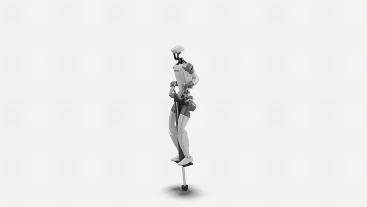
</p>

Built on MuJoCo Warp, [mjlab](https://github.com/mujocolab/mjlab) and rsl_rl.
This was the course project of Team 10 in CS4246/CS5446 (NUS, AY2026/27
Semester 1).

## Results

Three training runs of the recipe, 4000 PPO updates each (about 3 hours on one
GPU), evaluated in 256 worlds for 30 s per cell.

<table>
  <tr>
    <td align="center">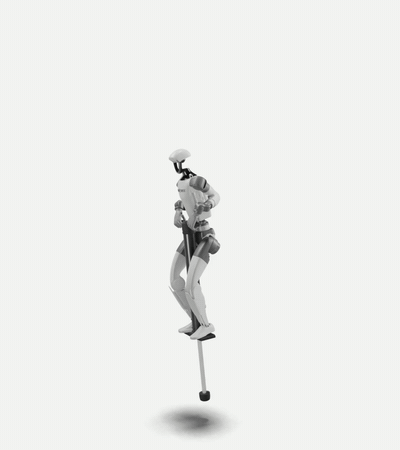</td>
    <td align="center">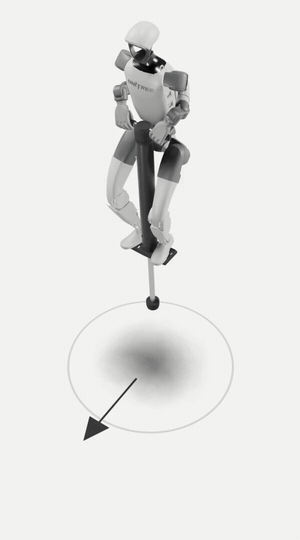</td>
    <td align="center">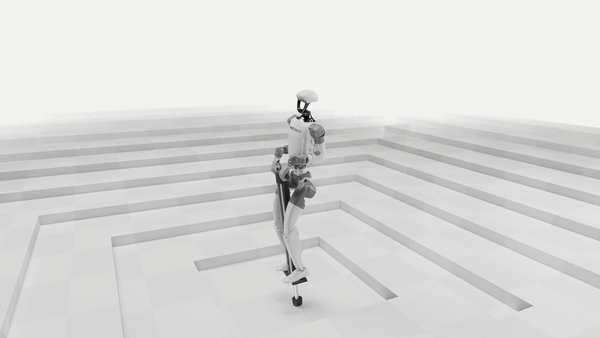</td>
  </tr>
  <tr>
    <td align="center">Hops up to 1 m</td>
    <td align="center">Turning on command</td>
    <td align="center">10 cm stairs, climbed blind after 2000 further updates</td>
  </tr>
</table>

- The policies keep hopping at five heights from 0.15 to 1.0 m under four
  commands (in place, forward at 0.3 m/s, turning at 0.5 rad/s, both). Every
  run succeeds in at least 96.5% of rollouts in each of the 20 cells.
- Height error stays within 2 cm. Hop-averaged yaw error is at most
  0.15 rad/s. Planar velocity error grows with hop height, from 0.14 to
  0.67 m/s, because a higher hop leaves fewer stance phases to correct it.
- A pure-pursuit follower steers each policy along an 18 m path that spells
  "NUS" through the same command interface. None of 192 rollouts falls, and
  the median distance from the path is 0.09 to 0.22 m.

<p align="center">
  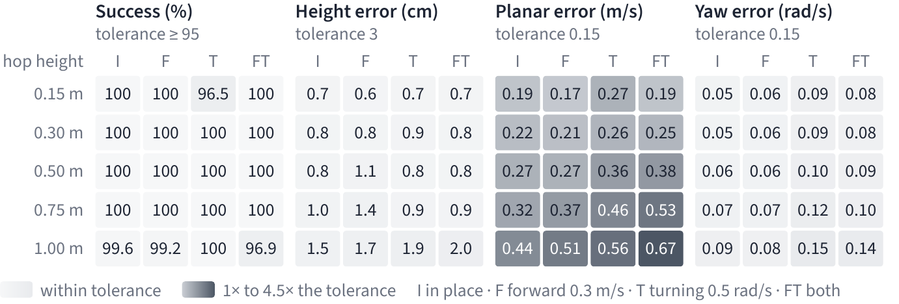
</p>

<p align="center">
  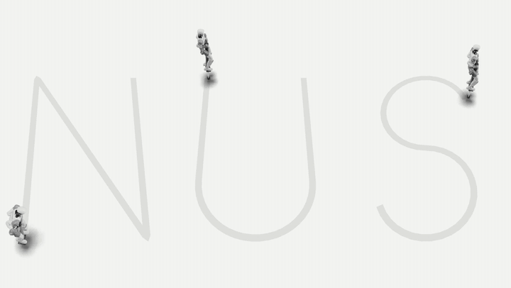
</p>

## What the reward has to score

The usual legged-locomotion reward scores each tracked quantity at every
control step. With that reward the rider learns to hop and to move, and after
4000 updates it still does not turn. Scoring each command once per hop, at
landing, teaches the full skill.

<p align="center">
  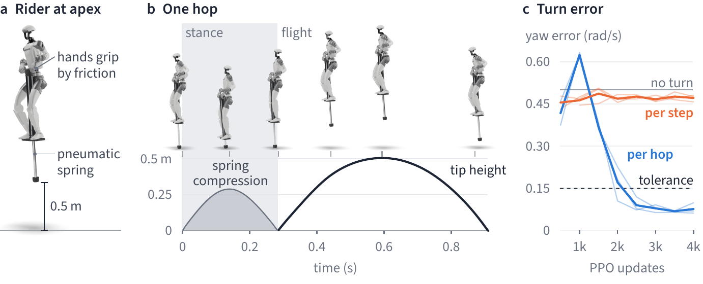
</p>

<p align="center">
  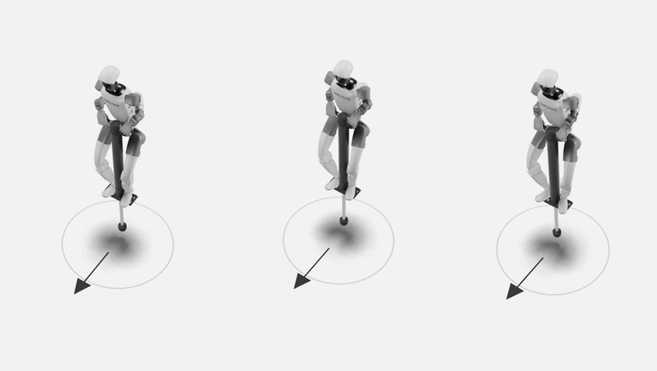
  <br>
  The same 0.5 rad/s turn command after 4000 updates. Left: scored per hop.
  Middle: scored per step. Right: scored per step on angular momentum.
</p>

The difference comes from the exploration noise PPO learns from. Under that
noise the pelvis yaw rate fluctuates by more than the turning command, so a
per-step reward on it pays almost the same whether the rider turns or not.
Only 8% of control steps land within tolerance in either case.

<p align="center">
  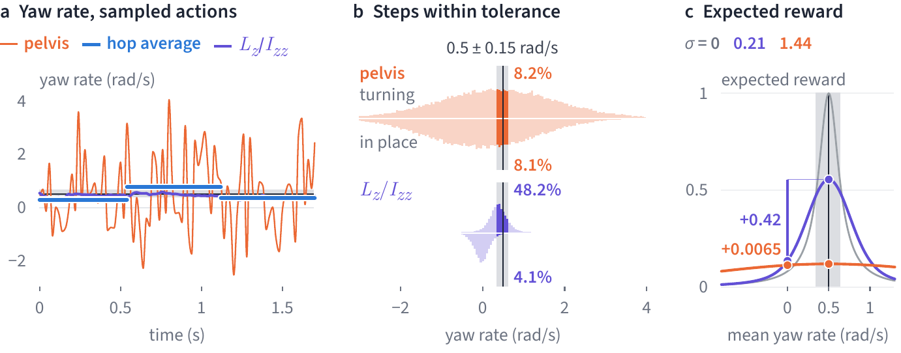
</p>

Scored quantities that fluctuate well below the command restore the signal:
the hop average, a moving average, and the angular momentum of rider and stick
(L<sub>z</sub>/I<sub>zz</sub>), which the joints leave unchanged in flight and
which teaches the turn earliest. On G1 flat walking the same comparison
predicted which reward learns the turn first.

<p align="center">
  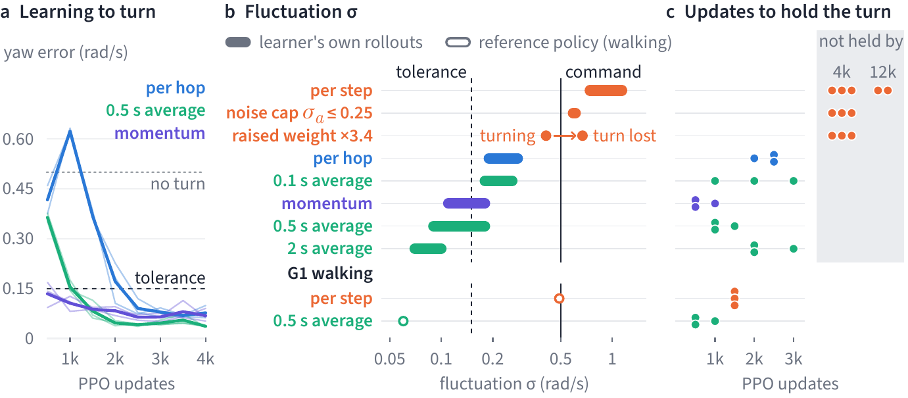
</p>

A practical check before a long run: record a few rollouts of an existing
policy with sampled actions and compare the fluctuation of each scored
quantity with its command (`scripts/studies/own_fluctuation.py`).

## Two things the rider needs

**A velocity estimate.** In flight the rider and stick fall together, so the
accelerometer reads zero and horizontal velocity is hidden from the onboard
sensors. The actor receives a noisy pelvis velocity in place of a state
estimator. Without it, none of three runs hops at 1 m.

<p align="center">
  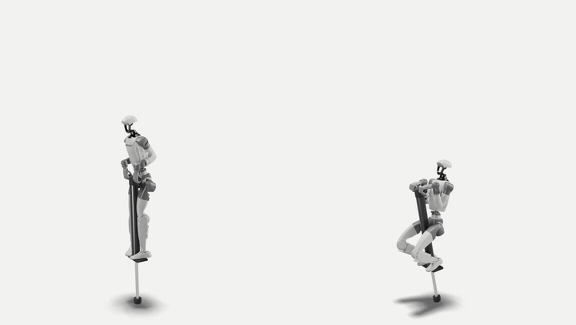
  <br>
  A 1 m command. Left: trained without the velocity estimate. Right: with it.
</p>

**A grip with margin.** The learned grasp keeps a safety factor of 1.25 to
1.67 on finger strength. Training for 2000 further updates with half-strength
fingers raises it above two, at a small cost in planar precision.

<p align="center">
  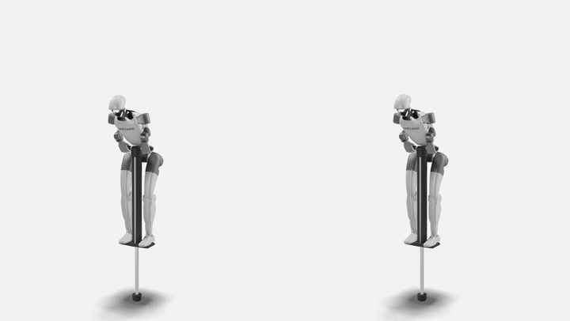
  <br>
  Both ride with fingers at 50% of rated torque. Left: trained at full
  strength. Right: trained with half-strength hands.
</p>

<p align="center">
  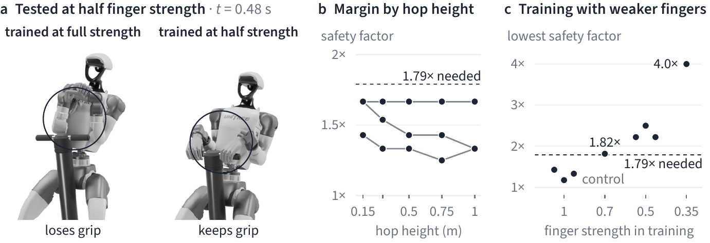
</p>

## How it works

<p align="center">
  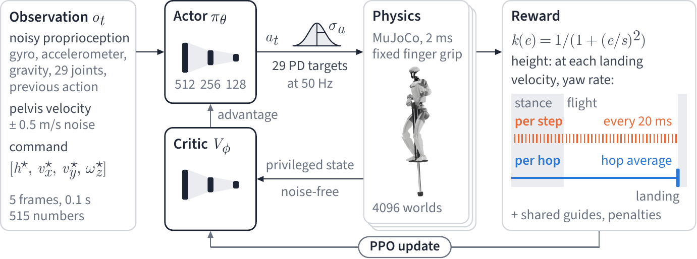
</p>

- **Physical model** (`pneumatic-v5`): a gas spring following the gas law
  (128 kPa gauge, 0.432 m stroke) with Small V4 Pro geometry, 4.54 kg, under a
  33.8 kg robot. Explicit material-pair contacts with elliptic friction cones,
  2 ms physics steps, 50 Hz policy. Drop tests at 2 ms and 1 ms agree within
  3%. Details: [docs/DESIGN.md](docs/DESIGN.md) section 2 and
  [docs/ASSETS.md](docs/ASSETS.md).
- **Policy**: 29 joint-position targets around the mounted pose. The 12 finger
  servos hold a fixed closing command under their torque limits. The actor
  sees five frames of noisy proprioception, the pelvis velocity and the
  command; the critic also sees privileged simulator state.
- **Reward**: height, planar velocity and yaw rate are scored at each landing
  against the hop's command, with a Cauchy kernel at the task tolerance (3 cm,
  0.15 m/s, 0.15 rad/s), plus weak dense guides and regularisers.
- **Curriculum**: the commanded height ceiling starts at 0.15 m and rises by
  5 cm each time the top band is practised without falls.

The recipe is specified in [docs/DESIGN.md](docs/DESIGN.md) section 3.

## Setup

Python 3.12, [uv](https://docs.astral.sh/uv/) and the committed lockfile.
Training needs an NVIDIA GPU (MuJoCo Warp).

```sh
uv sync --locked --extra train
scripts/fetch_assets.sh
uv run --locked --extra train pytest
uv run --locked --extra train python scripts/physics_checks.py
```

Two external assets stay outside git, under `data/`:

- `data/unitree_ros/`: Unitree's G1 + Revo2 URDF and meshes, fetched at a
  pinned commit by `scripts/fetch_assets.sh`.
- `data/assets/vurtego/`: the CC BY 4.0 pogo stick model. Download it from
  Sketchfab ([docs/ASSETS.md](docs/ASSETS.md)), then convert it with
  `scripts/prepare_asset.py`.

Run commands from the repository root. Checkpoints, videos and evaluation
results go to `artifacts/`, which is ignored.

## Pretrained policies

The three runs behind the results above, at 4000 updates, are on Hugging Face:
[zrgong/pogo-g1-ppo](https://huggingface.co/zrgong/pogo-g1-ppo).

```sh
hf download zrgong/pogo-g1-ppo --local-dir artifacts/runs
uv run --locked --extra train python scripts/play.py artifacts/runs/vel-obs-s0 \
  --ckpt model_4000.pt --worlds 64 --seconds 20 \
  --set 'apex=(0.5,0.5)' --set 'vx=(0.3,0.3)' --video
```

## Train, play, evaluate

```sh
uv run --locked --extra train python scripts/train.py --name vel-obs --iters 4001 --seed 0
uv run --locked --extra train python scripts/play.py artifacts/runs/<run> \
  --worlds 256 --seconds 30 --set 'apex=(0.3,0.3)' --set 'vx=(0.4,0.4)' --video
uv run --locked --extra train python scripts/eval_suite.py artifacts/runs/<run>
uv run --locked --extra train python scripts/capability.py artifacts/runs/<run> --ckpt model_4000.pt
```

`TaskCfg` in `src/pogo_g1/env.py` holds the recipe, and `--set` overrides any
field, for example `--set terrain=waves`, `--set params.pressure=128000` or
`--set robust=True`. `--resume` continues a run with its saved configuration;
`--warm-start` loads only the actor.

With a display, `scripts/play.py artifacts/runs/<run> --teleop` steers the
rider from the keyboard: W/S forward and back, A/D sideways, Q/E turn, X hop
in place. `scripts/demo_nus.py` drives the same interface with the path
follower.

## Reproducing the experiments

`scripts/queue_runs.sh` trains each line of a queue file and scores its
checkpoints. The queues in `scripts/queues/` are the report's conditions:

| Queue | Experiment |
|---|---|
| `baseline.txt` | the recipe (per-hop scoring), three seeds |
| `timescale.txt`, `timescale-long.txt` | per-step scoring, to 4000 and 12000 updates |
| `round2.txt` | 0.5 s moving average, potential-based height guide, no velocity input |
| `dose.txt` | raised weight; 0.1 s and 2 s averages |
| `maxstd.txt` | capped exploration noise |
| `centroidal.txt`, `complete.sh` | per-step scoring of angular momentum; half-strength fingers |
| `grip-sweep.sh`, `resume-full.sh` | grip margin against hand strength in training, with its control |
| `terrain.sh`, `walk.sh`, `path.sh` | stairs, G1 walking, resumes under per-step scoring |

The shell queues resume from the baseline runs under `artifacts/runs/`.
`scripts/studies/` holds the analyses behind the reward and grip results.

## Figures and media

- `figures/` holds the report's figures: `scripts/fig_data.py` writes
  `figures/data/*.json` from evaluation results, and `figures/src/build.py`
  renders the HTML templates to vector PDF and PNG
  ([figures/README.md](figures/README.md)).
- `docs/media/` holds the clips shown above, rendered in Blender from
  simulation states by `scripts/render/`.

## Layout

```
src/pogo_g1/
  pogo.py       passive pneumatic spring, plunger, losses and collision geometry
  contact.py    material-pair friction and contact compliance
  terrain.py    flat, wave, slope, rough, step and stairs presets
  robot.py      G1 + Revo2 hands: linkage, torque-limited servos, settled grasp
  assembly.py   mounted-pose IK and the CPU scene
  env.py        training configuration (TaskCfg)
  mdp.py        commands, observations, rewards, events, terminations, metrics
  ppo.py        PPO configuration
  symmetry.py   mirror augmentation
  evaluate.py   checkpoint loading and evaluation
scripts/
  train.py, play.py, eval_suite.py   training, rollout video, evaluation suite
  capability.py, push_phase.py       command matrix; push timing
  physics_checks.py, validate_gpu.py spring, drop, timestep and backend checks
  grip_capacity.py, hop_cycle.py     pull-out capacity; energy through the hop
  watch_curves.py                    score every Nth checkpoint during training
  demo_showcase.py, demo_nus.py      scripted command demos; path follower
  queue_runs.sh, queues/             the experiments
  studies/                           analyses behind the reward and grip results
  fig_data.py, render/               figure data; Blender stills and clips
figures/        figure sources, data and outputs
docs/           DESIGN.md (task, model, recipe, evaluation), ASSETS.md, media/
tests/          physics, contact, reward, evaluation and training tests
```

## Scope

- Simulation only, with a model built from manufacturer drawings and
  engineering estimates. Chamber volume, mass split and loss coefficients are
  design values.
- Episodes start mounted and grasping. Mounting and pickup are outside the
  task.
- The velocity input and the path follower read the simulator state. A
  physical attempt would need a velocity estimate that holds through flight
  and a grip margin verified on the real hand.

## Credits and licence

Code: MIT ([LICENSE](LICENSE)). Third-party components and their licences are
listed in [THIRD_PARTY.md](THIRD_PARTY.md).

The pogo stick in every render is adapted from "Vurtego Pogo Stick Model" by
RoboHoloclone12 (CC BY 4.0). The robot description comes from Unitree's
`unitree_ros` and mjlab.
